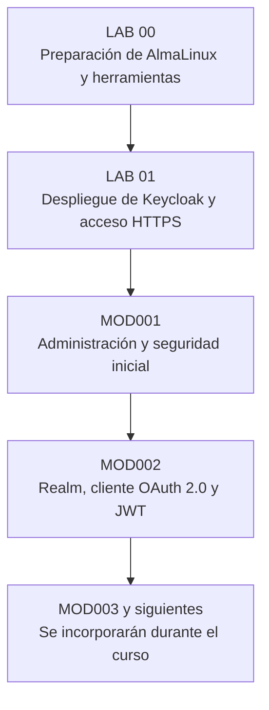
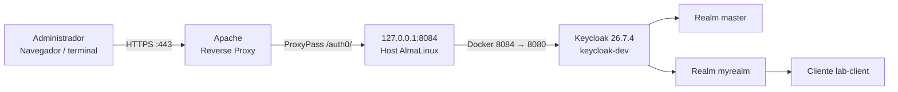

# Administración de Keycloak — Curso práctico y laboratorios

  

> **Bitácora técnica de aprendizaje.** Este repositorio reúne los ejercicios, configuraciones, comandos, resultados, errores y soluciones del curso de **Administración de Keycloak**, a partir de las clases y laboratorios guiados por el profesor **Patricio Canelo**.
>
> La colección crecerá módulo a módulo a lo largo del curso. Las prácticas están documentadas con explicaciones de **qué se hizo, por qué se hizo y cómo se validó**.

## ¿De qué trata este curso?

El curso aborda la **gestión de identidades y accesos (IAM)** utilizando **Keycloak** como plataforma de identidad (*Identity Provider, IdP*). Los laboratorios permiten comprender y aplicar conceptos de autenticación, autorización, federación de identidades, administración de usuarios, roles y clientes, y protocolos como **OAuth 2.0** y **OpenID Connect (OIDC)**.

La metodología es práctica: preparar una infraestructura Linux, desplegar Keycloak, administrarlo y explorar progresivamente sus funcionalidades. La documentación registra tanto los pasos exitosos como los problemas encontrados y las razones de las decisiones técnicas tomadas durante los ejercicios.

## Ruta de aprendizaje



Los laboratorios **LAB 00 y LAB 01 son la base de infraestructura**. Los módulos posteriores dan por preparada esa base y se concentran en el tema correspondiente, sin repetir la instalación completa.

## Índice de laboratorios

| Documento | Contenido | Estado |
|---|---|---|
| [**LAB 00 — Preparación de AlmaLinux**](README_Lab00_Keycloak.md) | VPS, acceso SSH, FQDN y DNS, Webmin/Virtualmin, Apache, Let's Encrypt, usuarios, Docker y Compose. | Documentado |
| [**LAB 01 — Instalación de Keycloak**](README_Lab01_Keycloak.md) | Keycloak en Docker, publicación por Apache Reverse Proxy, HTTPS, comprobaciones y solución de errores. | Documentado |
| [**MOD001 — Administración de Keycloak**](README_Lab_MOD001_Keycloak.md) | Acceso administrativo, administrador permanente, permisos, retiro del usuario bootstrap y verificaciones. | Documentado |
| [**MOD002 — OAuth 2.0 y JWT**](README_Lab_MOD002_Keycloak.md) | Creación de `myrealm`, cliente `lab-client`, flujo Client Credentials, obtención y análisis de Access Token. | Documentado |

> **Próximos módulos:** según lo indicado en clases, el programa podría abarcar alrededor de **90 módulos**. Esta cifra es orientativa; se agregarán los README a medida que se realicen y documenten, sin dar por completado material que aún no se ha trabajado.

## Entorno utilizado en los ejemplos

Las prácticas documentadas corresponden a **mi entorno personal de laboratorio**. No son valores universales ni una configuración lista para producción.

| Componente | Configuración utilizada en mi laboratorio |
|---|---|
| Sistema operativo | AlmaLinux 9.8 en VPS |
| Usuario SSH / Linux | `gperezz` |
| Dominio de ejemplo | `gperezz.planeta0.com` |
| Servidor web / proxy | Apache HTTP Server |
| Contenedores | Docker Engine |
| Administración de VPS | Webmin y Virtualmin |
| Certificados HTTPS | Let's Encrypt |
| Keycloak | Imagen `quay.io/keycloak/keycloak:26.7.4` |
| Nombre del contenedor | `keycloak-dev` |
| URL base utilizada | `https://gperezz.planeta0.com/auth0/` |
| Realms de los ejercicios | `master` y `myrealm` |
| Cliente OAuth de práctica | `lab-client` |

### ⚠️ Antes de copiar y ejecutar los comandos

**Debes reemplazar los datos propios de mi laboratorio por los tuyos.** Mi usuario `gperezz`, mi dominio y las rutas asociadas aparecen en comandos y capturas porque fueron los utilizados durante la ejecución real.

| Si ves en la guía… | Debes usar… |
|---|---|
| `gperezz` | **Tu usuario** de Linux o SSH (por ejemplo, `tuusuario`). |
| `gperezz.planeta0.com` | **Tu FQDN** o dominio configurado. |
| `ssh gperezz@gperezz.planeta0.com` | `ssh TU_USUARIO@TU_DOMINIO`. |
| `/home/gperezz` | El directorio personal de **tu usuario**, si corresponde. |
| `keycloak-dev`, `myrealm` o `lab-client` | Puedes conservar esos nombres para seguir el laboratorio, o adaptarlos de manera consistente. |
| Usuarios de administración de Keycloak | **Tus usuarios y contraseñas**, creados para tu instalación. |
| Contraseñas, *Client Secrets* y Access Tokens | **Tus propios secretos**. Nunca reutilices contraseñas de ejemplo ni publiques valores reales. |

**Importante:** el usuario SSH de Linux **no es lo mismo** que el usuario administrador de Keycloak. Cada cuenta pertenece a un sistema distinto y debe configurarse y protegerse de forma independiente.

Si un ejemplo utiliza una contraseña insegura de bootstrap por motivos históricos, **no la copies**: elige una contraseña robusta y sigue el procedimiento de reemplazo del administrador temporal. Del mismo modo, adapta IP, puertos y rutas si tu infraestructura es distinta; no cambies una parte de la configuración sin revisar sus dependencias (por ejemplo, el puerto de Docker y el `ProxyPass` de Apache).

### Ejemplo de adaptación

```bash
# Ejemplo original documentado
ssh gperezz@gperezz.planeta0.com

# Sustitúyelo por los datos de tu propio servidor
ssh TU_USUARIO@TU_DOMINIO
```

Para evitar compartir secretos accidentalmente, nunca subas al repositorio contraseñas, tokens JWT activos, archivos `.env`, llaves privadas (`*.pem`, `*.key`) ni volcados de configuración que contengan credenciales.

## Cómo utilizar este repositorio

1. Comienza por [LAB 00](README_Lab00_Keycloak.md) y verifica que tu servidor cumpla sus prerrequisitos.
2. Continúa con [LAB 01](README_Lab01_Keycloak.md) para disponer de una instancia funcional de Keycloak accesible por HTTPS.
3. Sigue los módulos en orden (`MOD001`, `MOD002`, etc.) y verifica cada resultado antes de avanzar.
4. Lee las secciones de **errores y soluciones**: incluyen incidencias reales del proceso de aprendizaje.
5. Adapta todos los nombres de usuario, contraseñas, dominios y valores particulares de tu infraestructura.

En los README se distinguen los **pasos efectivamente ejecutados**, las **verificaciones observadas** y las **recomendaciones complementarias**. Una recomendación no debe interpretarse como una configuración que ya esté implementada.

## Estructura del repositorio

```text
keycloack/
├── README.md                       # Portada, índice y convenciones
├── README_Lab00_Keycloak.md        # Preparación del servidor
├── README_Lab01_Keycloak.md        # Instalación y publicación de Keycloak
├── README_Lab_MOD001_Keycloak.md   # Administración inicial
├── README_Lab_MOD002_Keycloak.md   # OAuth 2.0 y JWT
└── ...                             # Más módulos conforme avance el curso
```

**Convención de nombres para módulos futuros:** `README_Lab_MOD003_Keycloak.md`, `README_Lab_MOD004_Keycloak.md`, etc., manteniendo numeración de tres dígitos. Cada nuevo módulo tendrá su propio README y se incorporará a la tabla de contenidos de este archivo.

## Arquitectura inicial de referencia



> El despliegue inicial se realizó con **`start-dev` y base H2**. Es apropiado únicamente como laboratorio: **no constituye una arquitectura de producción**, y no se debe eliminar ni recrear el contenedor suponiendo que existe persistencia externa. Para producción se requiere una configuración endurecida, almacenamiento persistente, gestión de secretos, respaldos y controles de acceso adecuados.

## Créditos y propósito

- **Docente y guía base:** Patricio Canelo — curso de Administración de Keycloak.
- **Ejecución y documentación del laboratorio:** [gperezz-cgr](https://github.com/gperezz-cgr).
- **Propósito:** compartir apuntes técnicos reproducibles y mejorar la comprensión de Keycloak mediante prácticas reales, sin presentar el repositorio como documentación oficial del producto o material oficial del curso.

---

**Este repositorio está en desarrollo continuo.** Se actualizará cada vez que se complete y documente un nuevo laboratorio.
