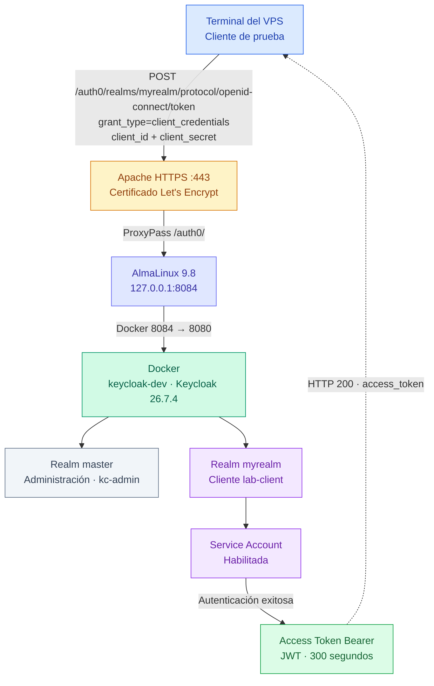

# Laboratorio MOD002 — Realm, cliente confidencial y OAuth 2.0 Client Credentials en Keycloak

> **Estado:** práctica ejecutada y verificada el 23 de octubre de 2026.  
> **Curso:** Administración de Keycloak — continuación del MOD001.  
> **Entorno:** AlmaLinux 9.8, Docker, Keycloak 26.7.4, Apache HTTPS y Virtualmin.  
> **Dominio:** `gperezz.planeta0.com`.  
> **Alcance comprobado:** crear `myrealm`, configurar `lab-client`, emitir un Access Token mediante `client_credentials`, decodificar claims y limpiar los secretos temporales.  
> **Importante:** la guía original íntegra del profesor para MOD002 no fue adjuntada; por ello este README documenta **la práctica realmente realizada**, sin afirmar que cubra requisitos no mostrados.

## Índice

1. [Objetivo y resultados](#1-objetivo-y-resultados)
2. [Arquitectura y conceptos](#2-arquitectura-y-conceptos)
3. [Prerrequisitos y verificaciones](#3-prerrequisitos-y-verificaciones)
4. [Paso 1 — Crear myrealm](#4-paso-1--crear-myrealm)
5. [Paso 2 — Verificar OIDC Discovery](#5-paso-2--verificar-oidc-discovery)
6. [Paso 3 — Crear lab-client](#6-paso-3--crear-lab-client)
7. [Paso 4 — Configurar Client Credentials](#7-paso-4--configurar-client-credentials)
8. [Paso 5 — Administrar el Client Secret](#8-paso-5--administrar-el-client-secret)
9. [Paso 6 — Solicitar un Access Token](#9-paso-6--solicitar-un-access-token)
10. [Paso 7 — Decodificar JWT y analizar claims](#10-paso-7--decodificar-jwt-y-analizar-claims)
11. [Paso 8 — Limpiar secretos y archivos](#11-paso-8--limpiar-secretos-y-archivos)
12. [Errores y soluciones](#12-errores-y-soluciones)
13. [Seguridad y límites de la prueba](#13-seguridad-y-límites-de-la-prueba)
14. [Checklist y cierre](#14-checklist-y-cierre)

---

## 1. Objetivo y resultados

**Objetivo:** comprender cómo Keycloak actúa como servidor de autorización y proveedor de identidad, creando un realm independiente y un cliente confidencial capaz de autenticarse sin usuario humano para obtener un **OAuth 2.0 Access Token**.

**Resultado real de la terminal:**

```text
HTTP 200
Access Token recibido: Sí
Token Type: Bearer
Expires In: 300 segundos
```

Además, el JWT contenía `iss` de `myrealm`, `azp=lab-client`, `aud=account` y una duración de **cinco minutos**. Se borró el archivo temporal y se eliminó la variable que contenía el secreto.

**Lo que NO se probó:** autenticación interactiva de usuarios, Authorization Code, autorización sobre una API protegida, validación criptográfica de la firma JWT, mapeo de audiencia para una API propia ni un entorno productivo.

## 2. Arquitectura y conceptos



**¿Por qué reutilizar esta arquitectura?** MOD001 ya demostró que Apache entrega HTTPS válido y redirige al contenedor que escucha únicamente en loopback. No era necesario exponer el puerto 8084 públicamente, recrear el contenedor ni cambiar el proxy para crear un realm y un cliente.

| Concepto | Explicación aplicada al laboratorio |
|---|---|
| **Realm** | Frontera lógica de identidades, clientes, roles, sesiones y configuración. `master` se reservó para administración; `myrealm` para la práctica. |
| **Client** | Aplicación o servicio registrado ante Keycloak. Su identificador es `lab-client`. |
| **Confidential client** | Cliente que se autentica ante Keycloak mediante un secreto; adecuado para procesos backend capaces de protegerlo, no para código público del navegador. |
| **Service account** | Identidad técnica vinculada al cliente para operar sin una persona iniciando sesión. |
| **OAuth 2.0** | Marco de autorización que permite emitir y utilizar tokens. |
| **Client Credentials grant** | Flujo máquina a máquina (M2M): el cliente se autentica y solicita un token, sin formulario de usuario. |
| **OIDC Discovery** | Documento JSON que anuncia endpoints y metadatos del realm; una respuesta HTTP 200 verifica su disponibilidad. |
| **Access Token** | Credencial temporal presentada normalmente como `Authorization: Bearer ...` ante un recurso protegido. |
| **JWT** | Formato de token con header, payload y firma; **decodificar** no es lo mismo que **validar**. |
| **Claims** | Atributos declarados dentro del token (`iss`, `aud`, `exp`, roles, etc.). |
| **Realm role / Client role** | Permisos definidos a nivel de realm o de cliente; su presencia en el JWT depende de asignaciones y mappers. |

## 3. Prerrequisitos y verificaciones

El MOD001 debía estar funcional antes de avanzar:

- VPS accesible por SSH con el usuario `gperezz`.
- Contenedor **existente** `keycloak-dev`, imagen `quay.io/keycloak/keycloak:26.7.4`.
- Acceso a `https://gperezz.planeta0.com/auth0/admin/` mediante el administrador permanente `kc-admin` en `master`.
- Apache HTTPS con Reverse Proxy hacia `127.0.0.1:8084`.
- `curl` y `python3` disponibles en el VPS.

**Dónde ejecutar:** los comandos Bash de este README se ejecutan en la terminal SSH **del VPS**, no en PowerShell. `127.0.0.1` se refiere al equipo donde se ejecuta el comando.

### 3.1. Comprobar que Keycloak sigue funcionando

```bash
docker ps --filter 'name=keycloak-dev'
curl -I https://gperezz.planeta0.com/auth0/
```

**Resultados observados:** contenedor `Up`, mapeo `127.0.0.1:8084->8080` y `HTTP 302` hacia `/auth0/admin/`.

**Por qué:** antes de atribuir un fallo a OAuth, comprobar que el servidor y el Reverse Proxy responden. Un `302` en la ruta base es la redirección esperada hacia la consola, no un fallo.

> **No ejecutar** `docker rm`, `docker run` de reemplazo ni `docker compose down` para esta práctica. El despliegue usa `start-dev` y H2 sin volumen externo configurado; recrearlo puede perder datos.

## 4. Paso 1 — Crear `myrealm`

1. Abrir `https://gperezz.planeta0.com/auth0/admin/`.
2. Iniciar sesión con **`kc-admin`**, administrador permanente del realm `master`.
3. Abrir el selector de realm, normalmente arriba a la izquierda, y entrar a **Manage realms → Create realm**.
4. Introducir **Realm name: `myrealm`**.
5. Mantener **Enabled = ON**.
6. No seleccionar un archivo de importación, porque se construirá un realm nuevo desde cero.
7. Pulsar **Create**.
8. Comprobar que aparecen `master` y `myrealm` y que el realm actual es **`myrealm`**.

**¿Por qué no usar `master`?** `master` concentra la administración del servidor. Separar el laboratorio en `myrealm` evita mezclar clientes y roles de práctica con las identidades administrativas. No significa crear otro contenedor: ambos realms viven en el mismo Keycloak.

**Resultado observado:** realm `myrealm` creado, habilitado y seleccionado.

## 5. Paso 2 — Verificar OIDC Discovery

Desde SSH:

```bash
curl -sS -o /dev/null -w 'HTTP %{http_code}\n' \
  'https://gperezz.planeta0.com/auth0/realms/myrealm/.well-known/openid-configuration'
```

**Resultado real:**

```text
HTTP 200
```

**Explicación de la ruta:**

- `/auth0/`: ruta pública de Keycloak establecida en MOD001.
- `/realms/myrealm/`: selecciona el realm recién creado.
- `/.well-known/openid-configuration`: endpoint estándar de metadatos OpenID Connect.

**Explicación de opciones:** `-sS` reduce mensajes de progreso pero mantiene errores; `-o /dev/null` descarta el JSON; `-w` imprime el código HTTP. Este comando **no muestra** secretos ni tokens.

**Qué demuestra:** el endpoint OIDC responde a través de HTTPS y Apache. **No demuestra aún** que un cliente pueda autenticarse.

## 6. Paso 3 — Crear `lab-client`

En la consola, con **`myrealm` seleccionado**:

1. Abrir **Clients → Create client**.
2. Elegir **Client type: OpenID Connect**.
3. Introducir **Client ID: `lab-client`**.
4. Definir **Name: `Laboratorio OAuth2`**.
5. Definir **Description: `Cliente para probar Client Credentials`**.
6. Continuar a la pantalla de capacidades y configurarlas como se indica en el paso siguiente.

**¿Por qué OIDC?** Keycloak expone mediante este tipo de cliente los endpoints y opciones necesarias para nuestra prueba de token. **¿Por qué un Client ID simple?** `lab-client` es el identificador que enviaremos literalmente en la solicitud al endpoint de token; debe coincidir con el registrado.

### 6.1. Always display in UI

Se habilitó **Always display in UI = ON** porque así lo indicó el profesor para esta práctica. Esta opción afecta a la presentación del cliente en interfaces compatibles; **no es un requisito técnico para el grant `client_credentials`**. No confundirla con autenticación ni con permisos.

## 7. Paso 4 — Configurar Client Credentials

En **Capability config**, se configuró:

| Opción | Valor aplicado | Motivo |
|---|---|---|
| **Client authentication** | **ON** | Necesitamos un cliente confidencial que se autentique con su secreto. |
| **Service account roles** | **ON** | Habilita la cuenta de servicio asociada al cliente y el flujo máquina a máquina. |
| **Standard flow** | **OFF** | No haremos login de usuario con Authorization Code en esta práctica. |
| **Direct access grants** | **OFF** | No usaremos el grant de contraseña de usuario. |
| **Implicit flow** | **OFF** | No se requiere para M2M; evitar flujos innecesarios. |
| **Authorization** | **OFF** | Los servicios de autorización propios de Keycloak no son necesarios para simplemente emitir el token de cliente. |
| **PKCE** | **OFF / no aplicado** | PKCE protege flujos de autorización interactiva; aquí no existe intercambio de authorization code. |
| **DPoP** | **OFF** | No se utilizó prueba de posesión en esta práctica. |

En **Login settings**, se dejaron sin configurar **Root URL**, **Home URL**, **Valid redirect URIs** y campos relacionados: **no hay navegador que deba recibir un callback** en `client_credentials`.

> **Incidencia de configuración:** durante la revisión apareció **Authorization = ON**. Se indicó cambiarlo a **OFF** porque era innecesario para el objetivo M2M. No debe confundirse esta opción con la autorización que una API aplicaría posteriormente a los roles del token.

Guardar o completar el asistente de creación del cliente. En la vista de detalle se observaron las pestañas **Settings, Keys, Credentials, Roles, Client scopes, Service account roles, Sessions, Advanced y Events**.

**Verificación visual:** cliente `lab-client` habilitado; **Always display in UI = ON**; pestaña **Credentials** disponible, consistente con autenticación de cliente habilitada.

## 8. Paso 5 — Administrar el Client Secret

### 8.1. Obtener el secreto desde Keycloak

1. En `myrealm`, abrir **Clients → lab-client → Credentials**.
2. Confirmar **Client Authenticator: Client Id and Secret**.
3. Confirmar que existe un **Client Secret** generado por Keycloak.
4. Copiar el secreto a un lugar seguro **sin pegarlo en el chat, capturas ni comandos literales**.

**¿Por qué el secreto?** Es una credencial compartida entre el cliente y Keycloak. La solicitud al endpoint de token la utiliza para demostrar que el proceso conoce la credencial del cliente. No equivale a una contraseña de usuario humano.

### 8.2. Incidente real: secreto compartido accidentalmente

Durante la práctica se intentó escribir el valor del secreto directamente como argumento de `read`. **Eso no es la sintaxis correcta**: `read` recibe el nombre de una variable, no su contenido. Además, se compartió el secreto accidentalmente en el chat.

**Solución indicada:** en la consola **Credentials → Regenerate**, generar un nuevo secreto, invalidar el anterior y utilizar únicamente el nuevo. **No se reproduce aquí ningún secreto real.**

### 8.3. Cargar el secreto de forma interactiva en Bash

En **la misma sesión SSH** donde se ejecutará `curl`:

```bash
read -rsp 'Introduce el Client Secret: ' KC_CLIENT_SECRET
echo
```

Cuando aparezca `Introduce el Client Secret:`, **pegar el nuevo valor y pulsar Enter**. No aparecerán caracteres: es el comportamiento esperado de `-s`.

| Elemento | Significado |
|---|---|
| `read` | Lee texto introducido por el operador. |
| `-r` | Evita interpretar barras invertidas como escapes. |
| `-s` | Oculta el texto durante la entrada. |
| `-p` | Muestra un mensaje de solicitud. |
| `KC_CLIENT_SECRET` | Nombre de la variable de Bash que recibirá el valor. |
| `echo` | Inserta un salto de línea después de la entrada oculta. |

Comprobar **sin mostrar el valor**:

```bash
if [[ -n "$KC_CLIENT_SECRET" ]]; then
    echo 'Client Secret cargado correctamente'
else
    echo 'ERROR: Client Secret vacío'
fi
```

**Resultado real:**

```text
Client Secret cargado correctamente
```

Esto **solo** demuestra que la variable tiene contenido; todavía no prueba que sea el secreto correcto. La verificación real vendrá del endpoint de token.

**Nota de seguridad:** `read -s` evita mostrar el secreto en pantalla y escribirlo literalmente en el historial, pero el valor **permanece en memoria del shell** hasta que se elimine. Para esta prueba puntual se prefirió a incrustar el secreto en el comando `curl`.

## 9. Paso 6 — Solicitar un Access Token

### 9.1. Llamar al endpoint OAuth 2.0

```bash
curl -sS -X POST \
  'https://gperezz.planeta0.com/auth0/realms/myrealm/protocol/openid-connect/token' \
  -H 'Content-Type: application/x-www-form-urlencoded' \
  --data-urlencode 'grant_type=client_credentials' \
  --data-urlencode 'client_id=lab-client' \
  --data-urlencode "client_secret=$KC_CLIENT_SECRET" \
  -o /tmp/keycloak-token-response.json \
  -w 'HTTP %{http_code}\n'
```

**Resultado real:**

```text
HTTP 200
```

### 9.2. Explicación línea por línea

| Parámetro | Función y razón |
|---|---|
| `curl` | Cliente HTTP para probar endpoints desde terminal. |
| `-sS` | Oculta progreso, pero informa errores. |
| `-X POST` | Solicita un token enviando datos al endpoint. |
| `/realms/myrealm/protocol/openid-connect/token` | Endpoint de emisión de tokens del realm `myrealm`. |
| `Content-Type: application/x-www-form-urlencoded` | Formato estándar del cuerpo de la petición OAuth. |
| `grant_type=client_credentials` | Indica que se solicita el grant M2M. |
| `client_id=lab-client` | Identifica el cliente registrado. |
| `client_secret=$KC_CLIENT_SECRET` | Aporta el secreto guardado en Bash, sin imprimirlo. |
| `--data-urlencode` | Codifica correctamente cada parámetro del formulario. |
| `-o /tmp/keycloak-token-response.json` | Guarda la respuesta para inspección local sin volcar el JWT a la consola. |
| `-w 'HTTP %{http_code}\n'` | Imprime únicamente el estado HTTP. |

**Interpretación:** `HTTP 200` indica que Keycloak procesó satisfactoriamente la solicitud. Debemos inspeccionar el JSON para comprobar que efectivamente contiene `access_token`.

**Precaución:** el archivo en `/tmp` contiene un token utilizable mientras sea válido. Para una nueva ejecución es preferible usar un directorio privado con permisos restringidos; aquí se documenta **la ruta que se usó realmente** y se elimina al finalizar.

### 9.3. Confirmar el token sin revelarlo

```bash
python3 - <<'PY'
import json

with open('/tmp/keycloak-token-response.json') as f:
    data = json.load(f)

if 'access_token' in data:
    print('Access Token recibido: Sí')
    print('Token Type:', data.get('token_type'))
    print('Expires In:', data.get('expires_in'), 'segundos')
else:
    print('Error:', data.get('error'))
    print('Descripción:', data.get('error_description'))
PY
```

**Resultado observado:**

```text
Access Token recibido: Sí
Token Type: Bearer
Expires In: 300 segundos
```

`python3` analiza el JSON sin imprimir el token. `Bearer` significa que quien posee el token puede presentarlo; `300` segundos equivalen a cinco minutos.

## 10. Paso 7 — Decodificar JWT y analizar claims

Un JWT compacto firmado tiene tres segmentos: `HEADER.PAYLOAD.SIGNATURE`. El payload está codificado en Base64URL, **no cifrado**. Decodificarlo **no verifica** la firma.

```bash
python3 - <<'PY'
import json
import base64
from datetime import datetime, timezone

with open('/tmp/keycloak-token-response.json') as f:
    token = json.load(f)['access_token']

parts = token.split('.')
if len(parts) != 3:
    raise SystemExit('El token no tiene el formato JWT compacto esperado')

payload = parts[1]
payload += '=' * (-len(payload) % 4)
claims = json.loads(base64.urlsafe_b64decode(payload))

for key in ('iss', 'azp', 'aud', 'typ'):
    print(f"{key}: {claims.get(key, 'No presente')}")

for key in ('iat', 'exp'):
    value = claims.get(key)
    if isinstance(value, (int, float)):
        date = datetime.fromtimestamp(value, timezone.utc)
        print(f'{key}: {date.isoformat()}')

print('Roles del Realm:', claims.get('realm_access', {}).get('roles', []))
print('Client roles presentes:', list(claims.get('resource_access', {}).keys()))
PY
```

**Explicación:** `json.load` lee el token guardado; `split('.')` separa sus tres partes; se añade el relleno `=` necesario para Base64URL; `urlsafe_b64decode` y `json.loads` convierten el payload a datos Python; `datetime.fromtimestamp` convierte fechas Unix a UTC. El comando no imprime el JWT completo ni `sub`.

**Resultado real:**

```text
iss: https://gperezz.planeta0.com/auth0/realms/myrealm
azp: lab-client
aud: account
typ: Bearer
iat: 2026-10-23T15:44:31+00:00
exp: 2026-10-23T15:49:31+00:00
Roles del Realm: ['default-roles-myrealm', 'offline_access', 'uma_authorization']
Client roles presentes: ['account']
```

| Claim | Interpretación |
|---|---|
| `iss` | Emisor: Keycloak del realm `myrealm`. |
| `azp` | Cliente autorizado `lab-client`. |
| `aud` | Audiencia `account`, **no** una API propia. |
| `typ` | Tipo `Bearer` declarado en el token. |
| `iat` | Emisión: 23-10-2026, 15:44:31 UTC. |
| `exp` | Expiración: 23-10-2026, 15:49:31 UTC. |
| `realm_access.roles` | Roles incluidos; no son roles de negocio creados por nosotros. |
| `resource_access` | Se comprobó la presencia de `account`, **no** se imprimieron sus roles internos. |

`exp - iat = 300 segundos = 5 minutos`.

**¿Por qué importa `aud`?** Una API protegida debe comprobar que el token está destinado a ella. Un token con `aud: account` no demuestra autorización para una futura API Spring Boot. Para ello se necesitaría configurar su audiencia y validar firma, emisor, expiración y permisos.

**Nota de terminal:** durante el pegado del comando apareció texto mezclado (`PYint(...)`), pero se obtuvo la salida esperada. Para repetir, copiar el bloque completo sin el prompt del shell.

## 11. Paso 8 — Limpiar secretos y archivos

```bash
unset KC_CLIENT_SECRET
rm -f /tmp/keycloak-token-response.json
```

`unset` elimina la variable de la sesión Bash y `rm -f` borra el archivo temporal que contiene el token. Se ejecutan **al final** porque los pasos previos necesitaban ambos valores.

```bash
if [[ -z "${KC_CLIENT_SECRET:-}" ]]; then
    echo 'Client Secret eliminado de la variable'
fi

if [[ ! -f /tmp/keycloak-token-response.json ]]; then
    echo 'Archivo temporal eliminado'
fi
```

**Resultado real:**

```text
Client Secret eliminado de la variable
Archivo temporal eliminado
```

Esto demuestra la ausencia de la variable y del archivo indicados, **no** un borrado forense ni la eliminación de copias en otros sistemas.

## 12. Errores y soluciones

| Síntoma | Causa o explicación | Solución |
|---|---|---|
| Se escribió el secreto como argumento de `read` | `read` espera un **nombre de variable** | Usar `read -rsp 'Introduce el Client Secret: ' KC_CLIENT_SECRET` y pegar el secreto después del prompt. |
| Se expuso el Client Secret | Credencial comprometida | Regenerar en **Credentials → Regenerate**; no volver a usar el anterior. |
| No se ven caracteres al introducir secreto | `read -s` oculta la entrada | Es normal; pulsar Enter y comprobar variable no vacía. |
| `HTTP 401` / `invalid_client` | ID, secreto o autenticación incorrectos | Revisar realm, `client_id`, secreto vigente y Client authentication ON. |
| `unauthorized_client` | Grant no permitido para cliente | Revisar Service account roles ON y cliente habilitado. |
| `HTTP 404` | Ruta o realm incorrectos | Verificar `/auth0/`, `myrealm` y endpoint OIDC Discovery. |
| `HTTP 503` | Apache no llega al contenedor | Revisar `docker ps`, logs y backend local. |
| `curl: (60)` | Problema TLS | Revisar certificado Apache del MOD001; no desactivar validación con `-k`. |
| Python informa `FileNotFoundError` | No existe JSON temporal | Repetir petición, analizar y limpiar al final. |
| Token expirado | `exp` vencido | Solicitar otro token con credenciales vigentes. |
| `aud: account` | No hay audiencia específica de API propia | Configurar audience mapper y validación en Resource Server antes de integrar. |

## 13. Seguridad y límites de la prueba

**Aplicado:** HTTPS válido, backend en loopback, realm de laboratorio separado, cliente M2M, secreto introducido interactivamente, JWT no impreso y limpieza final comprobada.

**Mejoras para una repetición:** usar un directorio temporal privado y `umask 077` en vez de una ruta predecible en `/tmp`; nunca guardar secretos en Git ni en frontend; rotar cualquier credencial expuesta; dar a la cuenta de servicio solo roles necesarios; validar JWT criptográficamente en la API. `start-dev` y H2 sin volumen persistente siguen siendo condiciones de **laboratorio**, no de producción.

**No realizado:** proteger un endpoint Spring Boot, configurar audiencia de API, comprobar firma con JWKS, configurar roles propios de negocio, ni migrar a PostgreSQL y backups.

## 14. Checklist y cierre

- [x] MOD001 operativo con `kc-admin` permanente.
- [x] Realm `myrealm` creado y habilitado.
- [x] OIDC Discovery devuelve `HTTP 200`.
- [x] Cliente OIDC `lab-client` creado y habilitado.
- [x] Nombre y descripción configurados.
- [x] Always display in UI ON por indicación del profesor.
- [x] Client authentication ON.
- [x] Service account roles ON.
- [x] Flujos interactivos innecesarios deshabilitados.
- [x] Client Secret generado, rotación indicada tras exposición y cargado sin imprimir.
- [x] POST `client_credentials` devuelve `HTTP 200`.
- [x] Access Token Bearer recibido, duración 300 segundos.
- [x] Claims JWT decodificados e interpretados.
- [x] Variable y archivo temporal eliminados y comprobados.
- [ ] Validar token en una API protegida (fuera del alcance ejecutado).
- [ ] Contrastar con todos los requisitos originales del MOD002 (guía completa no adjunta).
- [ ] Migrar a despliegue de producción (fuera de alcance).

### Secuencia completa

```text
MOD001 + kc-admin
  -> Crear myrealm
  -> Verificar OIDC Discovery (200)
  -> Crear lab-client OIDC
  -> Client authentication ON + Service account roles ON
  -> Credentials: Client Id and Secret
  -> Regenerar secreto expuesto
  -> read -rsp para cargar nuevo secreto
  -> POST /token con grant_type=client_credentials
  -> HTTP 200 + Bearer token (300 s)
  -> Decodificar JWT y examinar claims
  -> unset + rm temporal
  -> Confirmar limpieza
```

**Conclusión:** comprobamos la **emisión** de un token OAuth 2.0 para una cuenta de servicio de `lab-client` dentro de `myrealm` a través del Keycloak publicado con Apache HTTPS. No comprobamos su **autorización en una API externa**.
